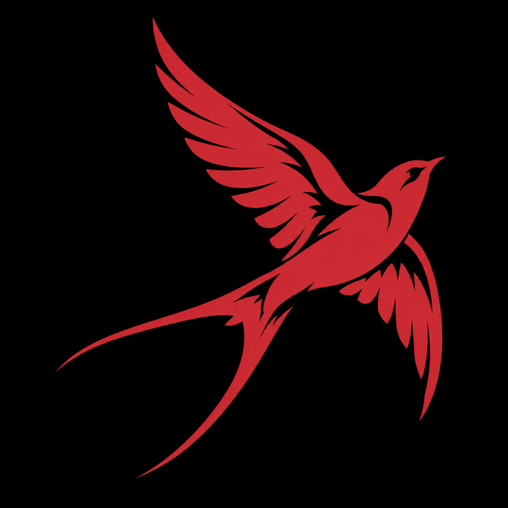
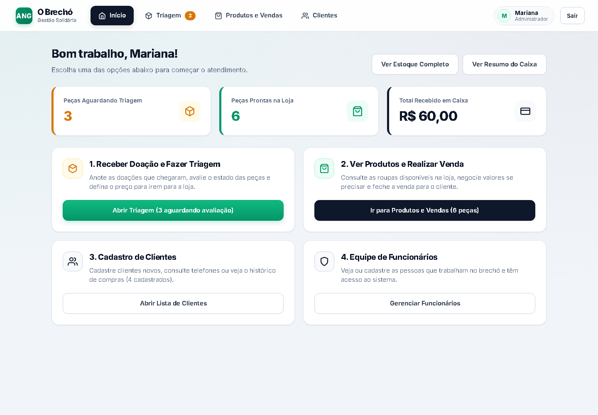

<p align="center"></p>

<p align="center"><sub>ANG</sub></p>

---

<div align="center">

# O-BRECHÓ
### Gestão solidária para a Associação Nova Geração

Projeto de **Análise e Desenvolvimento de Sistemas · Fatec Sorocaba · 2026**

[Documentação](docs/README.md) · [Telas](docs/prototipos/README.md) · [Requisitos](docs/requisitos/especificacao-requisitos.md) · [Como executar](frontend/README.md) · [Backlog](PRODUCT-BACKLOG.md)

</div>



*Tela atual do sistema, com dados de exemplo. Veja as [dez telas atuais](docs/prototipos/atual/README.md) e as [13 telas do primeiro protótipo](docs/prototipos/fichas-de-telas.md).*

## 📋 Informações do Projeto

| Campo | Informação |
|---|---|
| **Projeto** | O-BRECHÓ — Associação Nova Geração (ANG) |
| **Instituição** | Faculdade de Tecnologia de Sorocaba (FATEC Sorocaba) |
| **Curso** | Análise e Desenvolvimento de Sistemas (ADS) |
| **Equipe** | Arthur Mendes Entsev, Eduardo Kioshi Yasuoka, Gustavo Henrique Oliveira da Silva e Tiago Pereira Cortes |
| **Cliente / Parceiro** | Associação Nova Geração (ANG) |
| **Disciplina / Etapa** | Projeto Integrador (PI) |
| **Ano** | 2026 |
| **Última atualização** | 27/10/2026 |

Instituição, curso e ano: [Ver página 1](docs/academico/evidencias/estudo-ang/pagina-01.png). Nome da associação: [Ver página 3](docs/continuidade/evidencias/atividade-29-09-2026/pagina-03.png). Os nomes da equipe e a disciplina seguem os [ajustes feitos pela equipe no README](https://github.com/arthurlynow098/ANG/commit/0065fc8). [Responsabilidades e estimativa de custos](docs/academico/contexto-e-equipe.md).

## Resumo do projeto

A ANG atende uma comunidade em situação de vulnerabilidade social, principalmente crianças. Seu brechó vende produtos recebidos por doação. A receita das vendas é destinada às atividades da associação. [Ver página 4](docs/academico/evidencias/estudo-ang/pagina-04.png) · [Ver página 8](docs/academico/evidencias/estudo-ang/pagina-08.png).

O O-BRECHÓ reúne as informações de doações, triagem, produtos, clientes e vendas para ajudar a equipe no dia a dia. [Ver página 14](docs/academico/evidencias/estudo-ang/pagina-14.png).

## Problema, objetivos e avaliação

O projeto busca reduzir controles manuais e reunir as informações de estoque, vendas, clientes e caixa em um só lugar. O sistema será usado pela gestora e pela equipe da ANG. [Ver página 14](docs/academico/evidencias/estudo-ang/pagina-14.png).

O código já passou pela geração da versão de produção e pela verificação de tipos. Ainda precisamos testar os fluxos completos e avaliar o sistema com a ANG. [Ver resultados e próximos testes](docs/testes/plano-e-evidencias-de-testes.md).

## Escopo e situação desta versão

### O que já temos

- Aplicação React/TypeScript com login de demonstração, painel, doações, triagem, produtos, estoque, vendas, resumo de caixa, clientes e funcionários. [Ver telas atuais](docs/prototipos/atual/README.md).
- Modelo de dados com nove entidades e scripts SQL. [Ver modelo e scripts](docs/der/README.md).
- Documentos da equipe, requisitos, casos de uso e telas do primeiro protótipo. [Ver documentos](docs/fontes.md).

### O que fica fora do escopo

A proposta inicial não inclui loja virtual, entregas, várias unidades, consignação ou avaliação automática das peças. [Ver página 14](docs/academico/evidencias/estudo-ang/pagina-14.png).

Conforme os ajustes da equipe, o sistema também não terá agenda de atendimentos nem integração para processar pagamentos. Ele registra a forma de pagamento usada na venda. [Ver ajuste de escopo](https://github.com/arthurlynow098/ANG/commit/0065fc8) · [Ver página 8](docs/academico/evidencias/estudo-ang/pagina-08.png).

### O que ainda falta

Os dados ficam no navegador de cada computador. O login ainda é de demonstração. Também faltam ajustes no histórico por categoria, nos relatórios por período e na aprovação das peças pela gestora. [Ver o que falta em cada requisito](docs/requisitos/rastreabilidade.md).

O planejamento cita PostgreSQL, mas os scripts existentes usam MySQL. A equipe precisa alinhar isso antes de conectar o sistema ao banco. [Ver comparação](docs/arquitetura/visao-arquitetural.md).

Os clientes, produtos e valores mostrados nas telas são dados de exemplo. As informações sobre a ANG e sobre o projeto vêm dos documentos da equipe.

## Organização do código

```text
ANG/
├── frontend/                 # Código da aplicação web
├── data/database/            # Scripts do banco de dados
├── docs/
│   ├── academico/            # Estudo, equipe e custos estimados
│   ├── requisitos/           # O que o sistema deve fazer
│   ├── casos-de-uso/         # Passo a passo das operações
│   ├── der/                  # Estrutura dos dados
│   ├── arquitetura/          # Organização técnica do sistema
│   ├── prototipos/           # Telas atuais e primeiro protótipo
│   ├── testes/               # Testes feitos e testes planejados
│   ├── decisoes/             # Decisões do projeto
│   ├── continuidade/         # Histórico e evolução
│   ├── backlog/              # Lista de tarefas em CSV
│   └── ferramentas/          # Scripts usados na documentação
└── PRODUCT-BACKLOG.md        # Lista de tarefas do projeto
```

Os serviços TypeScript atuais rodam no navegador e ficam em `frontend/`. Outras pastas serão usadas quando a equipe criar novos componentes. [Ver organização do código](docs/arquitetura/ARQUITETURA.md).

## Onde encontrar cada informação

| Assunto | Link |
|---|---|
| Aplicação e execução | [Como executar](frontend/README.md) |
| Estrutura dos dados | [Modelo e dicionário](docs/der/README.md) |
| Requisitos e operações | [Requisitos](docs/requisitos/README.md) e [casos de uso](docs/casos-de-uso/README.md) |
| Telas | [Versão atual](docs/prototipos/atual/README.md) e [primeiro protótipo](docs/prototipos/fichas-de-telas.md) |
| Testes | [Resultados e plano de testes](docs/testes/README.md) |
| Trabalho acadêmico | [Estudo da equipe](docs/academico/README.md) |
| Documentos originais | [Quatro PDFs e suas páginas](docs/fontes.md) |

## Requisitos e código

| Necessidade | Requisitos | Caso de uso | Situação |
|---|---|---|---|
| Clientes e histórico | RF01, RF02 | UC01, UC02 | Cadastro e histórico prontos; falta agrupar por categoria |
| Equipe e acesso | RF03, RNF01, RNF02 | UC03 | Funciona como demonstração; falta segurança para uso real |
| Doações e avaliação | RF04, RF05 | UC04, UC05 | Fluxo pronto; falta restringir a aprovação à gestora |
| Produtos e estoque | RF06 | UC06 | Falta alinhar as categorias ao documento |
| Vendas e caixa | RF07, RF08 | UC07, UC08 | Venda e resumo prontos; falta consultar por período |

Os links para os requisitos, o código e os pontos pendentes estão na [tabela de acompanhamento](docs/requisitos/rastreabilidade.md). As próximas tarefas ficam no [backlog](PRODUCT-BACKLOG.md).

## Histórico do projeto

O estudo, a atividade e o primeiro protótipo mostram as etapas anteriores ao React atual. [Ver evolução e documentos de cada etapa](docs/continuidade/linha-de-base-e-evolucao.md).

## Como começar

Use Node.js compatível com Vite 6 (Node 22 recomendado) e npm.

```bash
git clone https://github.com/arthurlynow098/ANG.git
cd ANG/frontend
npm ci
npm run dev
```

Abra o endereço informado pelo Vite, normalmente `http://localhost:5173`. Usuários de exemplo: `admin`, `atendente` ou `clara`, com senha `123456`. Para gerar a versão de produção: `npm run build`. [Instruções completas](frontend/README.md).

---

<p align="center"><sub>Estudo · construção · evolução</sub><br><a href="https://github.com/arthurlynow098">Perfil</a> · <a href="https://arthurentsev.vercel.app/">Portfólio</a></p>
