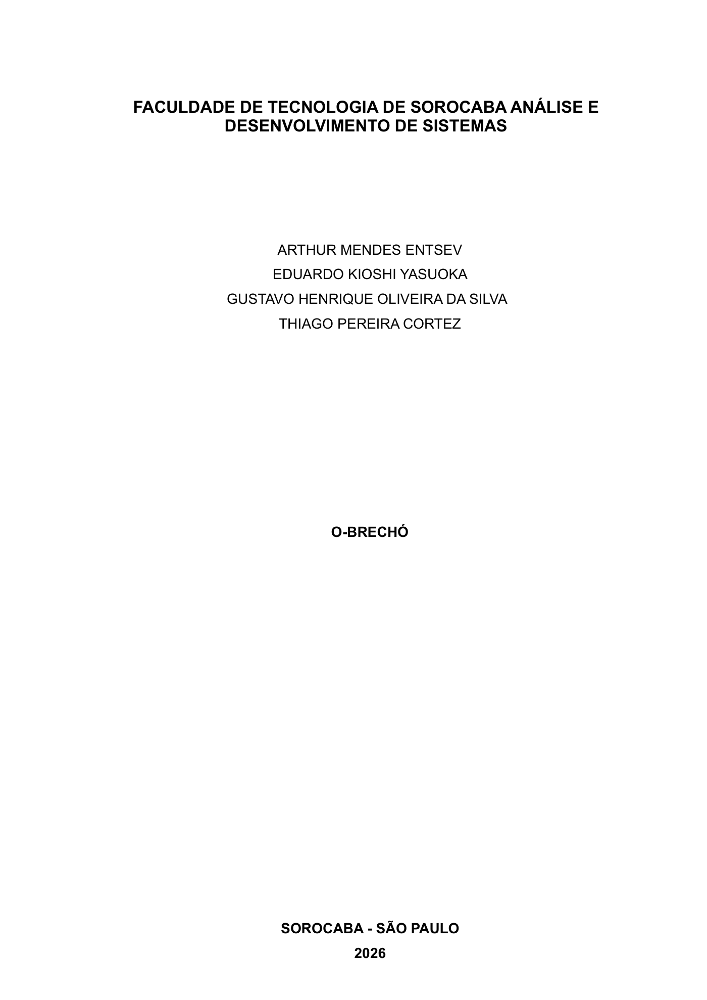

# Estudo do projeto

| Documento | Conteúdo |
|---|---|
| [Estudo da ANG](fontes/2209ANG.pdf) | Contexto, funcionamento do brechó, equipe, custos, pesquisa e requisitos |
| [Projeto, equipe e custos](contexto-e-equipe.md) | Responsabilidades e estimativa de trabalho |
| [Referencial teórico](referencial-teorico.md) | Pesquisa sobre brechós, logística e sistemas semelhantes |
| [Páginas do estudo](evidencias/estudo-ang/README.md) | Consulta por imagem |

## Como consultar

Comece pelo [contexto e pela equipe](contexto-e-equipe.md) para conhecer as responsabilidades e a estimativa de trabalho. Para consultar a pesquisa e conferir sua origem, use o [referencial teórico](referencial-teorico.md) junto ao [estudo original](fontes/2209ANG.pdf).
