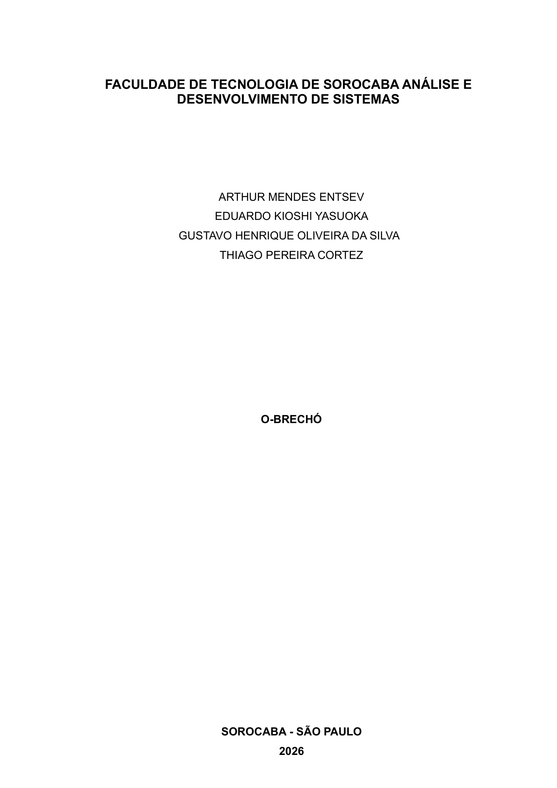

# Estudo acadêmico e contexto

| Documento | Finalidade | Evidência |
|---|---|---|
| `2209ANG.pdf` | Estudo de 31 páginas: contexto, operação, equipe, custos estimados, pesquisa, requisitos e casos de uso | [Abrir PDF](fontes/2209ANG.pdf) · [Ver todas as páginas](evidencias/estudo-ang/README.md) |
| Contexto e equipe | Consulta rápida às informações do estudo, com origem por página | [Ler síntese](contexto-e-equipe.md) |
| Referencial teórico | Índice dos temas e pesquisa de similares preservados no estudo | [Ler índice](referencial-teorico.md) |

O estudo identifica Sorocaba — São Paulo, 2026. [Ver página 1](evidencias/estudo-ang/pagina-01.png).
