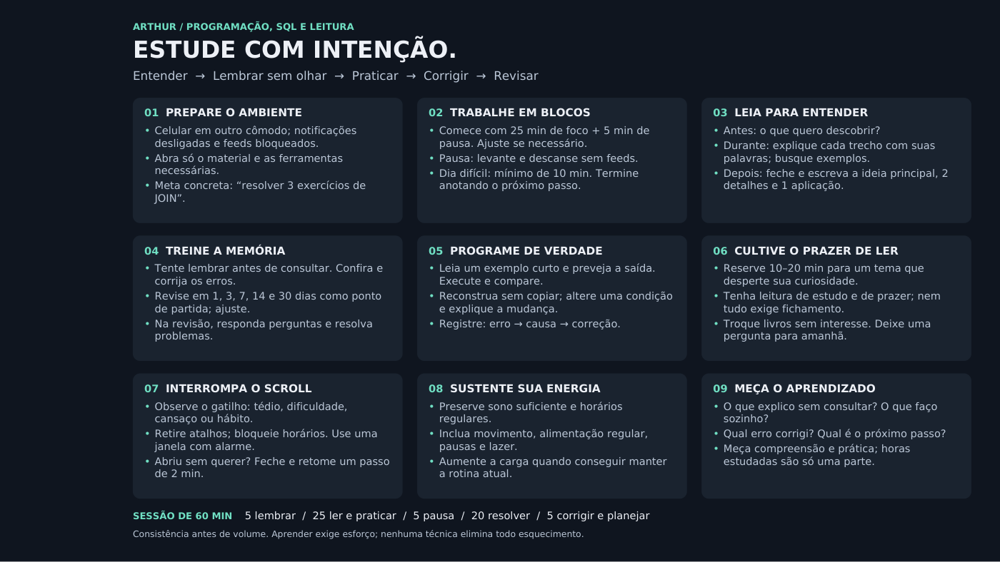

# Material de apoio ao estudo

O arquivo [Protocolo-de-Estudo.pdf](fontes/Protocolo-de-Estudo.pdf) é um material pessoal de apoio a programação, SQL e leitura identificado para Arthur. Foi incluído para preservar todos os arquivos fornecidos, em uma categoria separada do escopo e das regras do O-BRECHÓ.

Seu conteúdo aborda preparação do ambiente, blocos de estudo, leitura, memória, prática, revisão e acompanhamento do aprendizado. Não constitui protocolo de pesquisa com a ANG nem evidência de teste de usuário.

[Captura e fonte](evidencias/protocolo-de-estudo/README.md).
