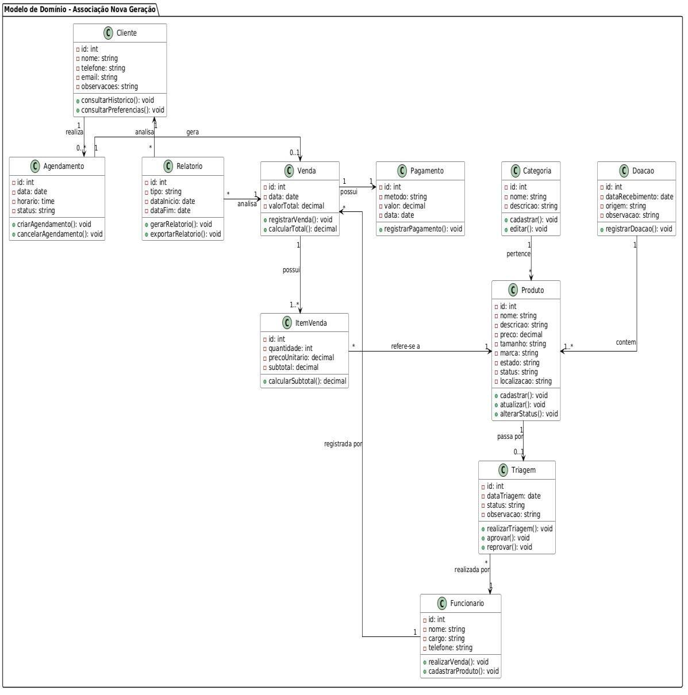

# Arquitetura

A aplicação usa React e TypeScript. As telas, regras de negócio e acesso aos dados ficam separados em camadas.

| Documento | Conteúdo |
|---|---|
| [Visão geral](visao-arquitetural.md) | Componentes atuais e tecnologias planejadas |
| [Classes de domínio](diagrama-classes.md) | Entidades e responsabilidades |
| [Organização em camadas](ARQUITETURA.md) | Estrutura das pastas do frontend |
| [DER e dicionário](../der/README.md) | Estrutura dos dados |

[Modelo no estudo, página 31](../academico/evidencias/estudo-ang/pagina-31.png).

Agendamento e Relatorio aparecem no desenho inicial, mas não existem como entidades no banco atual. A agenda está fora do escopo desta versão.

## Como consultar

Leia a [visão arquitetural](visao-arquitetural.md) antes de consultar a [organização em camadas](ARQUITETURA.md). Use o [diagrama de classes](diagrama-classes.md) para entender o domínio e compare-o com o [modelo de dados](../der/README.md), observando os conceitos ainda não implementados.
