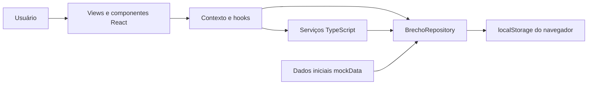

# Arquitetura — O-BRECHÓ

## Visão atual

Código em `frontend/src/`: models/types descrevem entidades; repositories persistem localmente; services agrupam regras; context/hooks compartilham estado; views/components apresentam a interface. Não existe backend nesta versão. Scripts em `data/database/` não são executados pelo frontend.

A [descrição herdada](ARQUITETURA.md) foi preservada com caminhos atualizados. O acesso é demonstrativo: a função de hash não é SHA-256 criptográfico e o serviço permite a senha padrão. Evolução para produção depende de backend e requisitos próprios.

Modelos `-template` foram preservados como referência do professor.
