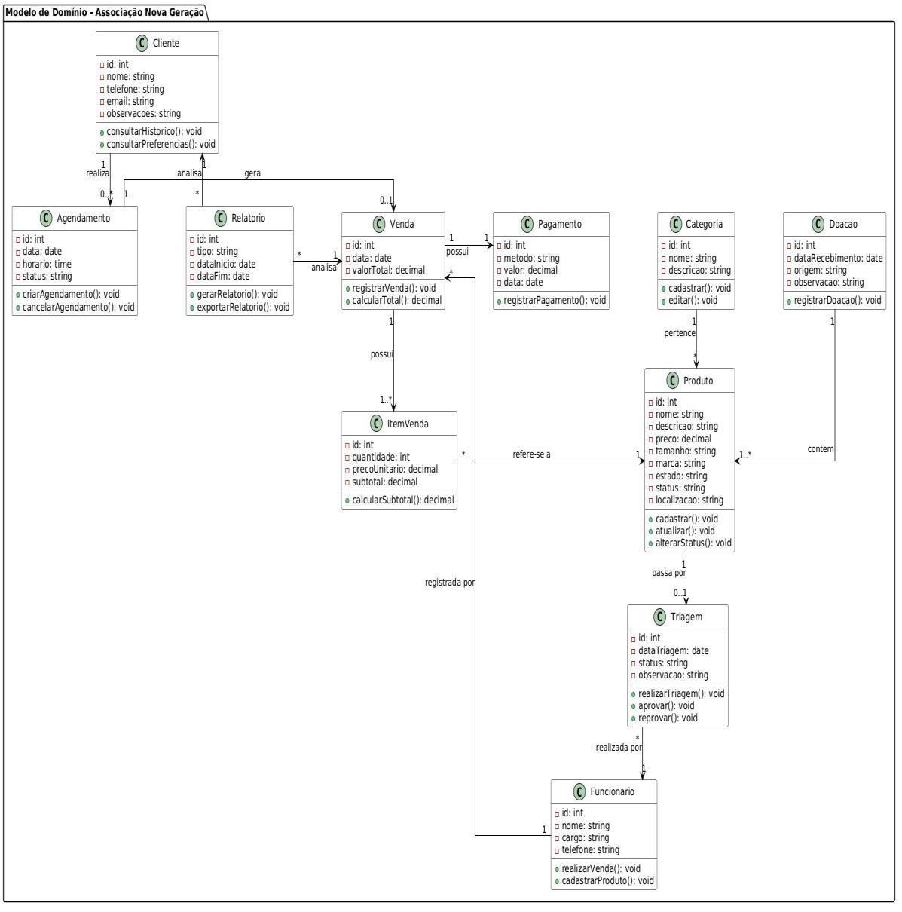
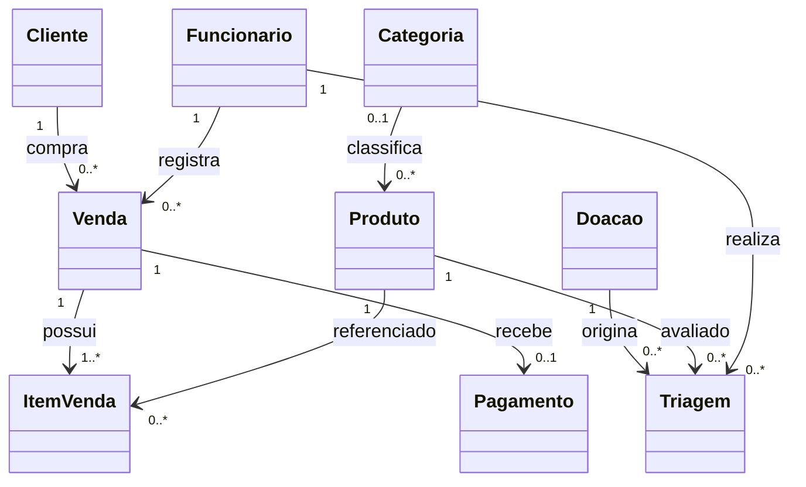

# Classes de domínio

## Modelo original da equipe

Fonte: [estudo, página 31](../academico/fontes/2209ANG.pdf). A imagem foi extraída diretamente do PDF.

## Responsabilidades

| Classe no modelo | Responsabilidade | Correspondência atual |
|---|---|---|
| Cliente | Identificação, contato, histórico e preferências | models/Cliente.ts e telas de clientes |
| Agendamento | Data, horário, status e cancelamento do atendimento | Não implementado |
| Relatorio | Tipo, intervalo e geração/exportação | Não há entidade; tela atual de resumo sem intervalo ou exportação |
| Venda | Data, valor e registro comercial | models/Venda.ts e VendaService |
| ItemVenda | Peça, quantidade, preço e subtotal | models/ItemVenda.ts |
| Pagamento | Método, valor e data | models/Pagamento.ts |
| Categoria | Nome e descrição | models/Categoria.ts |
| Doacao | Entrada, origem e observação | models/Doacao.ts e TriagemService |
| Produto | Descrição, preço, tamanho, marca, estado e localização | models/Produto.ts |
| Triagem | Avaliação, situação e aprovação/reprovação | models/Triagem.ts e operações de contexto |
| Funcionario | Equipe responsável pelas operações | models/Funcionario.ts; acrescenta usuário e senha_hash |

O modelo original associa doação e produto diretamente. No SQL atual, o vínculo é representado pelos registros de TRIAGEM, que contêm `doacao_id` e `produto_id`. As interfaces atuais representam dados; métodos do desenho conceitual são distribuídos entre contexto e serviços, em vez de métodos de instância dessas interfaces.

## Relações dos tipos implementados

Este mapa resume relações dos tipos e restrições SQL, não acrescenta classes ausentes. O SQL não impõe unicidade de `ITEM_VENDA.produto_id`; a intenção de venda única por peça depende da regra de aplicação. `PAGAMENTO.venda_id` é único, mas o SQL não força a existência de um pagamento para toda venda. Consulte o [dicionário](../der/dicionario-de-dados.md).
