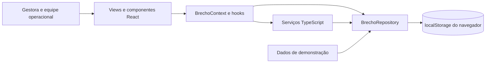

# Visão arquitetural — O-BRECHÓ

## 1. Identificação e escopo

Projeto ANG, aplicação web demonstrativa e planejamento acadêmico de 2026. Esta visão descreve a implementação atual e as diferenças para a [Ver página 6](../continuidade/evidencias/atividade-29-09-2026/pagina-06.png). Atualizada em 2026-10-27.

## 2. Contexto e componentes atuais

O código efetivamente executado fica em `frontend/`. Não há comunicação com uma API ou banco SQL nesta versão.

## 3. Responsabilidades e evidências

| Elemento | Responsabilidade | Tecnologia e caminho | Estado |
|---|---|---|---|
| Interface | Navegação, formulários e apresentação | React 18 / views e components | Implementada em demonstração |
| Estado | Compartilhar dados e operações | context/BrechoContext.tsx, hooks/ | Implementado |
| Serviços | Operações de triagem, venda e acesso | services/ | Executados no navegador |
| Repositório | Carregar e salvar dados locais | repositories/BrechoDatabase.ts | localStorage |
| Entidades | Estrutura dos nove registros | models/ e types/ | Interfaces TypeScript |
| Build | Compilar e servir frontend | Vite 6, TypeScript, Tailwind | Build e tipos verificados |
| Banco relacional | Estrutura SQL de referência | data/database/ | Não conectado |

## 4. Tecnologias previstas versus presentes

| Tecnologia | Planejamento documentado | Implementação atual |
|---|---|---|
| React / Tailwind | [Ver página 6 da atividade](../continuidade/evidencias/atividade-29-09-2026/pagina-06.png) | Presentes no package.json |
| Shadcn/UI | [Ver página 6 da atividade](../continuidade/evidencias/atividade-29-09-2026/pagina-06.png) | Não instalado |
| Node.js / TypeScript / Express | Backend previsto na atividade p. 6 | Node usado nas ferramentas; TypeScript no frontend; Express ausente |
| PostgreSQL | Banco previsto na atividade p. 6 | Sem integração; SQL existente tem sintaxe MySQL |

Antes de integrar dados, decidir como migrar/revisar o SQL existente para a tecnologia adotada. Não alterar a descrição de planejamento para fazer parecer que o backend existe.

## 5. O que falta e próximos passos

Autenticação é demonstrativa e não representa autorização segura. A função chamada `gerarSenhaHash` não é SHA-256 criptográfico; a senha padrão é aceita pelo serviço. A persistência é isolada por navegador e pode ser apagada localmente. RNF01, RNF02, RNF05 e RNF07 exigem evolução e validação próprias.

As visões de contexto, componentes e domínio são suficientes para explicar esta entrega. Um backend futuro exigirá atualizar a comunicação, autenticação, transações e persistência. [Backlog](../../PRODUCT-BACKLOG.md), [decisões](../decisoes/README.md) e [rastreabilidade](../requisitos/rastreabilidade.md).
