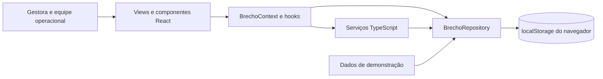

# Visão arquitetural

## 1. Identificação e escopo

O O-BRECHÓ é uma aplicação web em React e TypeScript. A versão atual roda no navegador. O backend e o banco compartilhado ainda estão planejados. [Tecnologias previstas](../continuidade/evidencias/atividade-29-09-2026/pagina-06.png).

## 2. Contexto e componentes atuais

O código da aplicação fica em `frontend/`. Não há comunicação com uma API ou banco SQL nesta versão.

## 3. Componentes

| Elemento | Responsabilidade | Tecnologia e caminho | Estado |
|---|---|---|---|
| Interface | Navegação, formulários e apresentação | React 18 / views e components | Implementada em demonstração |
| Estado | Compartilhar dados e operações | context/BrechoContext.tsx, hooks/ | Implementado |
| Serviços | Operações de triagem, venda e acesso | services/ | Executados no navegador |
| Repositório | Carregar e salvar dados locais | repositories/BrechoDatabase.ts | localStorage |
| Entidades | Estrutura dos nove registros | models/ e types/ | Interfaces TypeScript |
| Build | Compilar e servir frontend | Vite 6, TypeScript, Tailwind | Build e tipos verificados |
| Banco relacional | Estrutura SQL de referência | data/database/ | Não conectado |

## 4. Tecnologias

| Tecnologia | Planejamento documentado | Implementação atual |
|---|---|---|
| React / Tailwind | [Ver página 6 da atividade](../continuidade/evidencias/atividade-29-09-2026/pagina-06.png) | Presentes no package.json |
| Shadcn/UI | [Ver página 6 da atividade](../continuidade/evidencias/atividade-29-09-2026/pagina-06.png) | Não instalado |
| Node.js / TypeScript / Express | Backend previsto na atividade p. 6 | Node usado nas ferramentas. TypeScript no frontend. Express ausente |
| PostgreSQL | Banco previsto na atividade p. 6 | Sem integração. SQL existente tem sintaxe MySQL |

Precisamos adaptar os scripts MySQL para o banco escolhido antes de conectar o frontend ao backend.

## 5. O que falta e próximos passos

O login ainda usa contas de demonstração e aceita a senha padrão. A função `gerarSenhaHash` precisa ser substituída por um método adequado para uso real. Os dados ficam no navegador e ainda não são compartilhados entre computadores. Essas mudanças fazem parte dos requisitos RNF01, RNF02, RNF05 e RNF07.

O próximo passo é criar o backend e integrar autenticação, vendas e armazenamento dos dados. [Backlog](../../PRODUCT-BACKLOG.md), [decisões](../decisoes/README.md) e [rastreabilidade](../requisitos/rastreabilidade.md).
