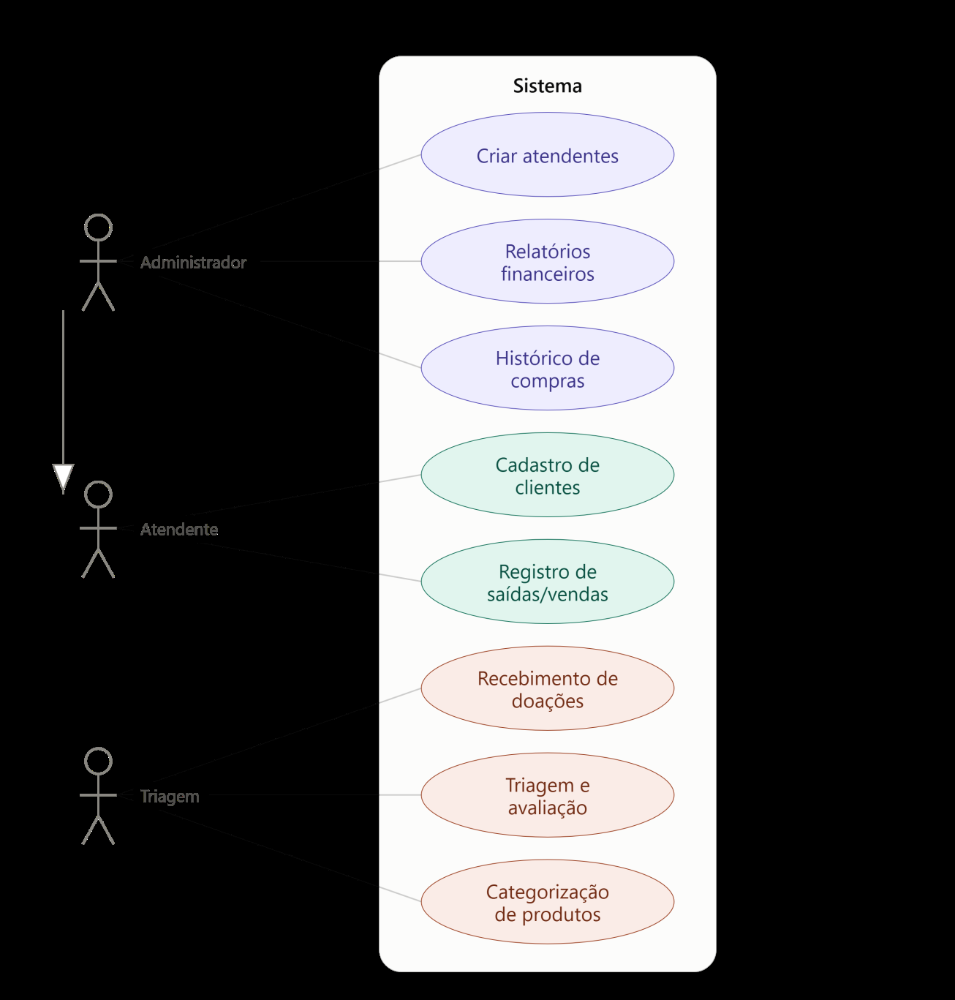

# Casos de uso — O-BRECHÓ

Os documentos descrevem os atores **Administrador**, **Atendente** e **Responsável pela Triagem**. O administrador herda as operações do atendente. A aprovação final exclusiva pela gestora é uma regra adicional do contexto.

- [Oito casos de uso detalhados](casos-de-uso-detalhados.md), alinhados a RF01–RF08.
- [Diagrama e comparação das duas fontes](diagrama-casos-de-uso.md).
- [Ver página 19](../academico/evidencias/estudo-ang/pagina-19.png) · [Ver página 20](../academico/evidencias/estudo-ang/pagina-20.png) · [Ver página 21](../academico/evidencias/estudo-ang/pagina-21.png) · [Ver página 22](../academico/evidencias/estudo-ang/pagina-22.png) · [Ver página 23](../academico/evidencias/estudo-ang/pagina-23.png) · [Ver página 24](../academico/evidencias/estudo-ang/pagina-24.png) · [Ver página 25](../academico/evidencias/estudo-ang/pagina-25.png) · [Ver página 26](../academico/evidencias/estudo-ang/pagina-26.png) · [Ver página 27](../academico/evidencias/estudo-ang/pagina-27.png) · [Ver página 28](../academico/evidencias/estudo-ang/pagina-28.png) · [Ver página 29](../academico/evidencias/estudo-ang/pagina-29.png) · [Ver página 30](../academico/evidencias/estudo-ang/pagina-30.png).
- [Ver página 5](../requisitos/evidencias/requisitos-funcionais/pagina-05.png).

Os IDs UC01–UC08 organizam esta versão Markdown; os nomes, atores e fluxos vêm dos documentos da equipe. As diferenças para o código atual estão na [rastreabilidade](../requisitos/rastreabilidade.md).
