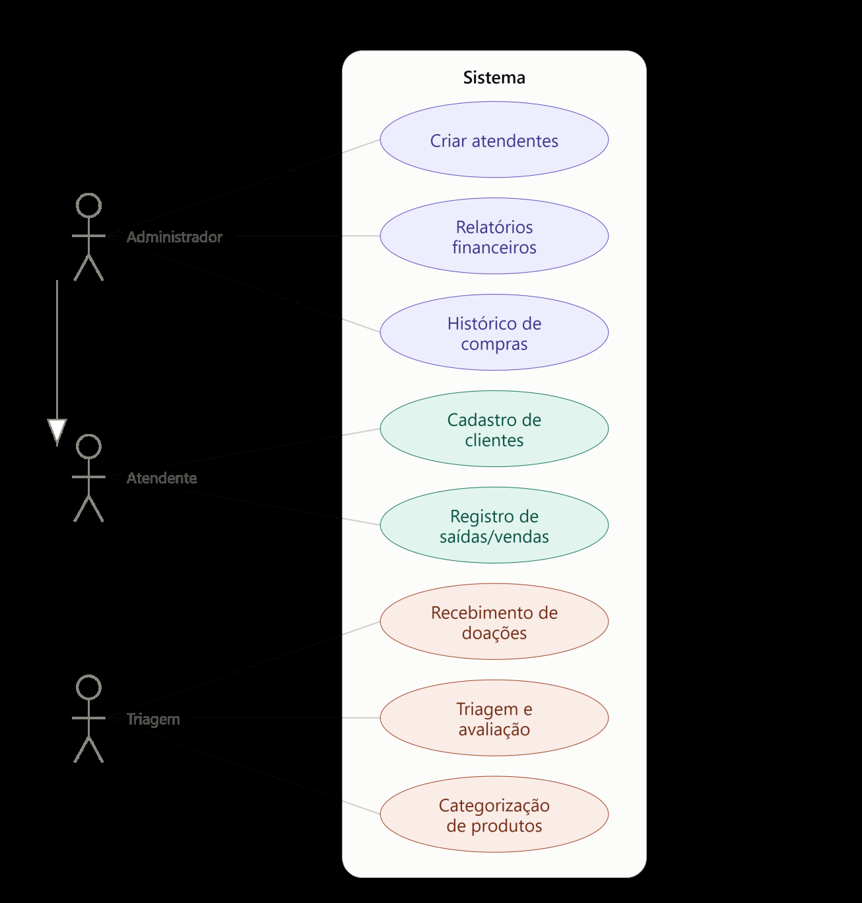

# Casos de uso

O atendente cadastra clientes e registra vendas. O administrador também consulta históricos, cadastra atendentes e acompanha os relatórios. O responsável pela triagem recebe as doações, avalia as peças e define suas categorias.

- [Operações detalhadas](casos-de-uso-detalhados.md)
- [Diagramas e perfis de acesso](diagrama-casos-de-uso.md)
- [Diagrama no documento de requisitos](../requisitos/evidencias/requisitos-funcionais/pagina-05.png)
- [Diagrama no estudo](../academico/evidencias/estudo-ang/pagina-30.png)

A aprovação final das peças cabe à gestora Aline. [Regra de triagem](../academico/evidencias/estudo-ang/pagina-07.png).

## Como consultar

Consulte os [diagramas](diagrama-casos-de-uso.md) para identificar os perfis de acesso e as operações de cada ator. Em seguida, leia os [casos detalhados](casos-de-uso-detalhados.md) e compare os fluxos com a [especificação de requisitos](../requisitos/especificacao-requisitos.md).
