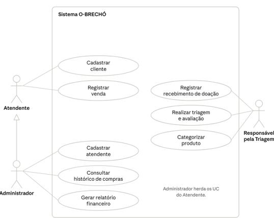

# Diagramas de caso de uso

## Documento de requisitos — oito objetivos

Fonte: [Ver página 5](../requisitos/evidencias/requisitos-funcionais/pagina-05.png). O diagrama contém os oito objetivos associados a RF01–RF08. O administrador especializa o atendente; Triagem é um ator próprio.

## Estudo acadêmico — versão preservada

Fonte: [Ver página 30](../academico/evidencias/estudo-ang/pagina-30.png). Esta figura apresenta sete elipses e não inclui explicitamente o histórico de compras, embora esse fluxo esteja descrito nas páginas 21–22 do mesmo estudo. A versão de requisitos acima e os oito casos detalhados mantêm RF02 visível. Ambas as figuras foram preservadas sem alteração.

## Mapa textual dos atores

| Ator | Objetivos documentados |
|---|---|
| Atendente | UC01 cadastrar cliente; UC07 registrar venda |
| Administrador | UC02 consultar histórico; UC03 criar atendente; UC08 gerar relatório; operações herdadas do atendente |
| Responsável pela Triagem | UC04 receber doação; UC05 avaliar peça; UC06 categorizar produto |

A regra de aprovação final pela gestora Aline está registrada no contexto do estudo e precisa ser alinhada com o ator Triagem e com as permissões da implementação.
