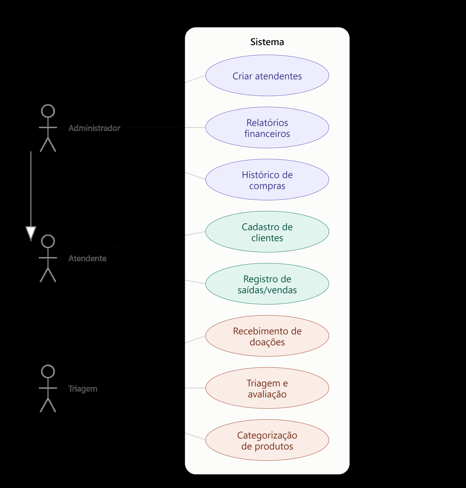
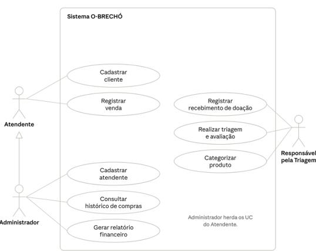

# Diagramas de caso de uso

## Diagrama de requisitos

O administrador pode realizar as operações do atendente e tem acesso às funções de gestão. A triagem recebe, avalia e classifica as peças. [Documento de requisitos, página 5](../requisitos/evidencias/requisitos-funcionais/pagina-05.png).

## Diagrama inicial

O desenho inicial não inclui o histórico de compras. Essa operação aparece no diagrama de requisitos e nos casos de uso. [Desenho no estudo, página 30](../academico/evidencias/estudo-ang/pagina-30.png).

## Perfis de acesso

| Ator | Objetivos documentados |
|---|---|
| Atendente | UC01 cadastrar cliente; UC07 registrar venda |
| Administrador | UC02 consultar histórico; UC03 criar atendente; UC08 gerar relatório; operações herdadas do atendente |
| Responsável pela Triagem | UC04 receber doação; UC05 avaliar peça; UC06 categorizar produto |

A aprovação final das peças cabe à gestora Aline. Ainda precisamos aplicar essa restrição às permissões do sistema. [Regra de triagem](../academico/evidencias/estudo-ang/pagina-07.png).
