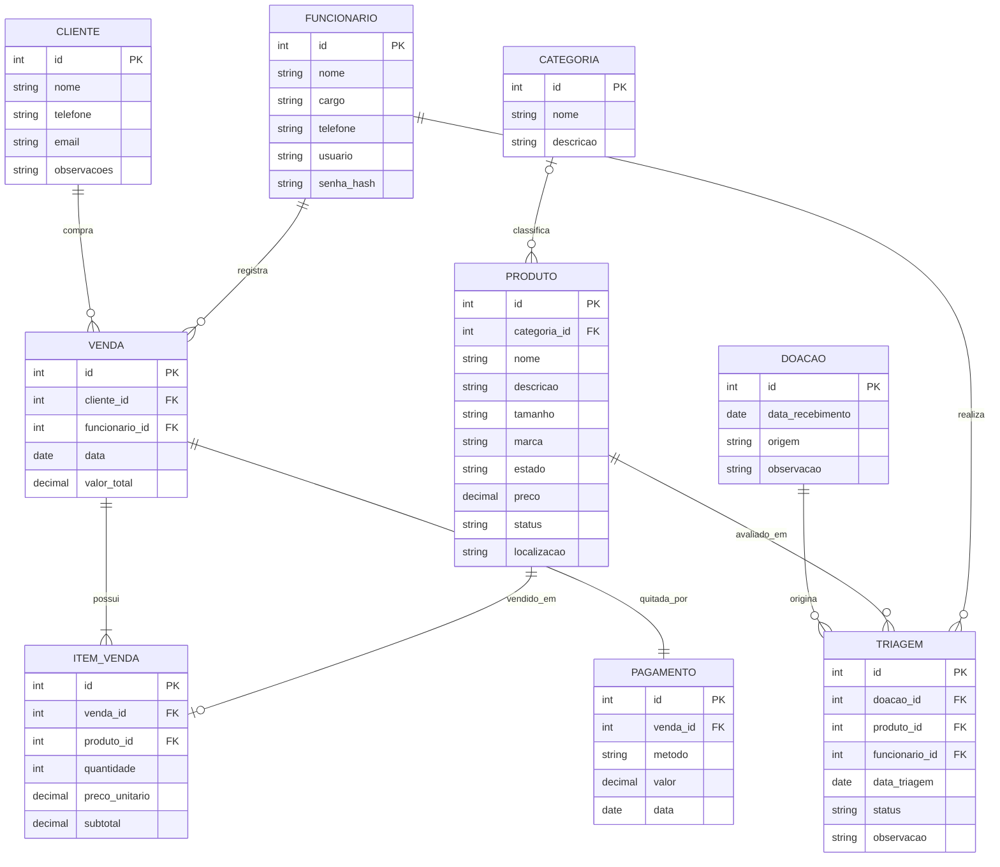

# Diagrama Entidade-Relacionamento (DER) — O-BRECHÓ (Projeto ANG)

Este documento descreve a modelagem relacional oficial do sistema **O-BRECHÓ**, composta estritamente por **9 tabelas**.

## Fluxo Operacional de Dados

1. **Entrada de Doação (`DOACAO` ➔ `PRODUTO` ➔ `TRIAGEM`)**:
   - Registra a entrada na tabela `DOACAO`.
   - Cria o registro da peça em `PRODUTO` com `status = 'aguardando_triagem'` e `categoria_id = null`.
   - Cria a avaliação em `TRIAGEM` com `status = 'Pendente'`.
2. **Avaliação na Triagem (`TRIAGEM` ➔ `PRODUTO`)**:
   - **Aprovar:** Atualiza `TRIAGEM.status = 'Aprovado'` e define `PRODUTO.categoria_id`, `PRODUTO.preco`, `PRODUTO.localizacao` e `PRODUTO.status = 'disponivel'`.
   - **Descartar:** Atualiza `TRIAGEM.status = 'Reprovado'` (com motivo em `observacao`) e `PRODUTO.status = 'reprovado'`.
3. **Fechamento de Venda (`VENDA` ➔ `ITEM_VENDA` + `PAGAMENTO`)**:
   - Cria o registro em `VENDA` vinculando `cliente_id` e `funcionario_id`.
   - Registra cada peça negociada em `ITEM_VENDA` (`preco_unitario` e `subtotal`).
   - Registra a quitação em `PAGAMENTO` (`metodo`, `valor`, `data`).
   - Atualiza `PRODUTO.status = 'vendido'`.

