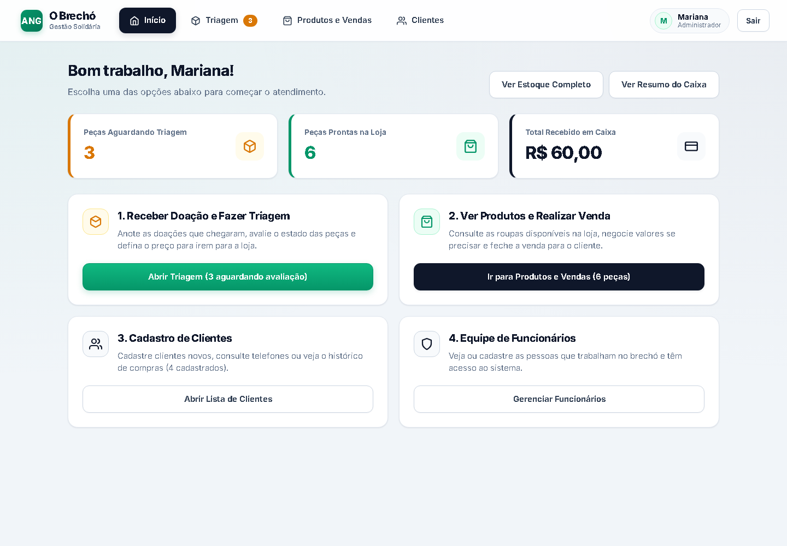
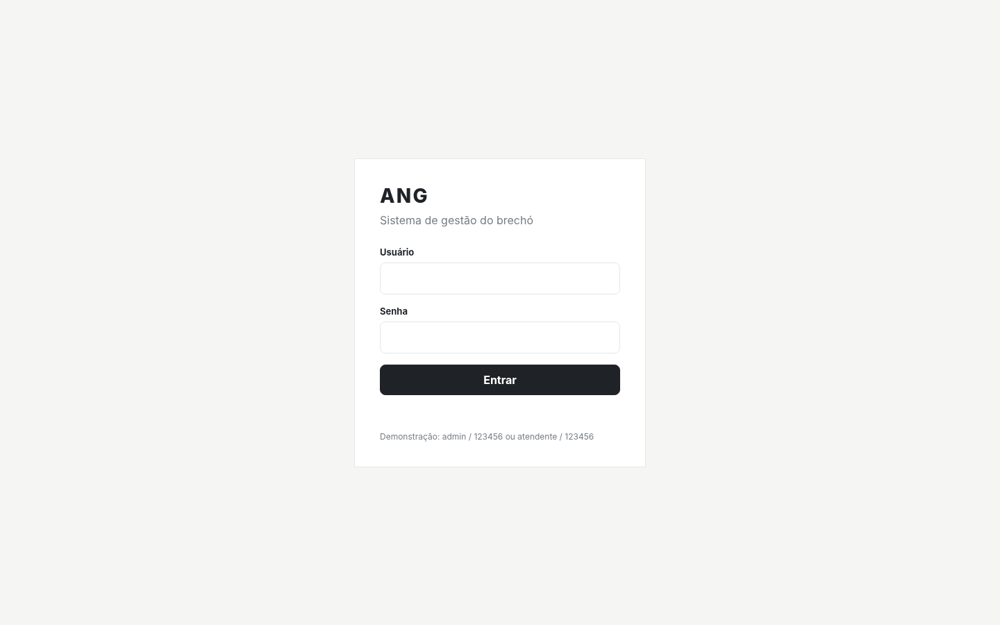
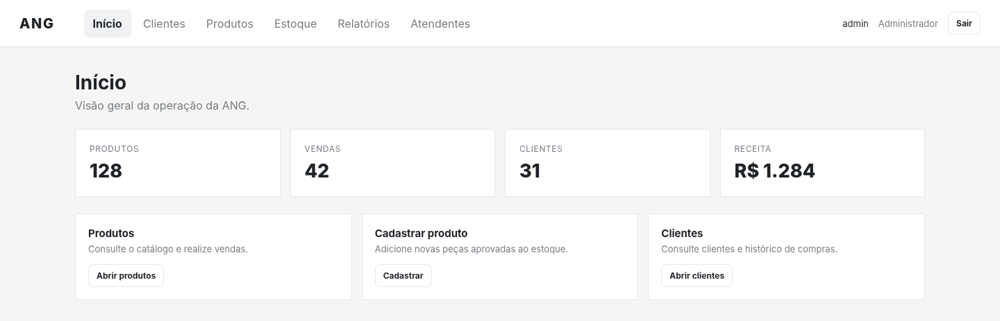
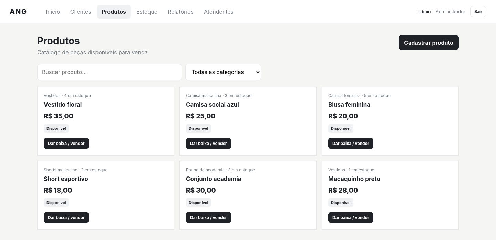
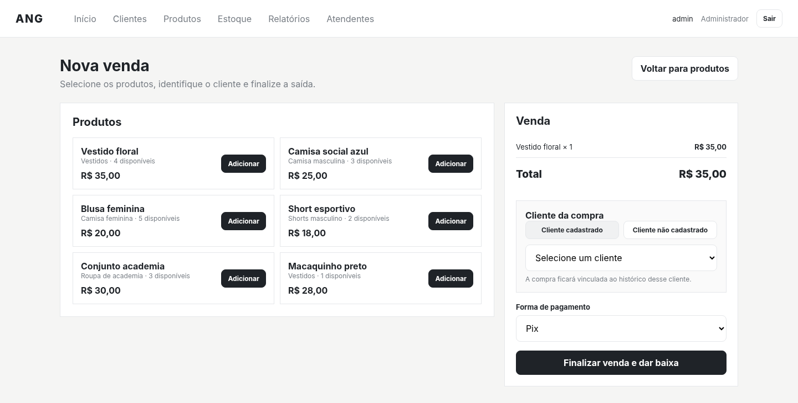
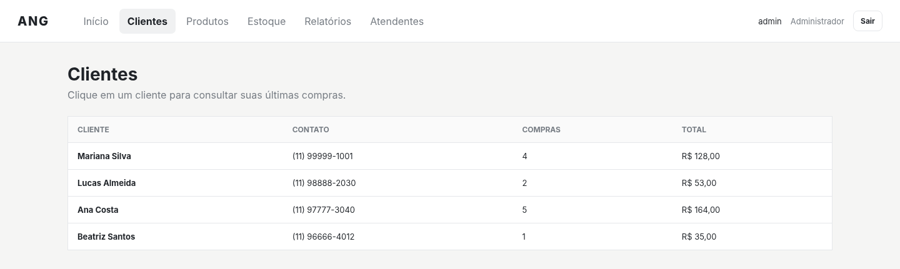
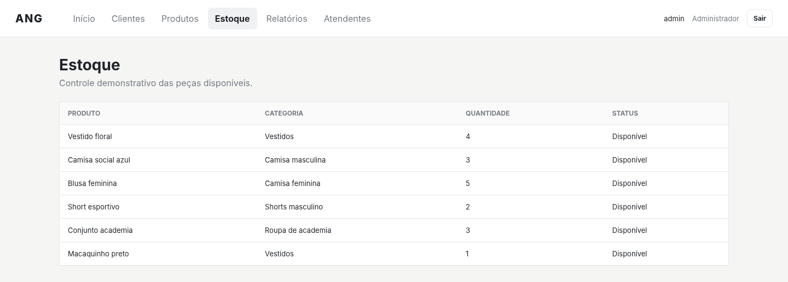

# Telas do sistema

## Versão atual

[Telas em React](atual/README.md) · [Registro das capturas](atual/capturas.json)

A aplicação reúne doações, triagem, produtos, vendas, clientes, estoque, caixa e equipe. As telas usam dados de exemplo.

## Primeiro protótipo

[Telas e funcionamento](fichas-de-telas.md) · [Documento em PDF](fontes/telasANG.pdf) · [Páginas do documento](evidencias/telas-ang/README.md) · [Protótipo em HTML](Protótipo_inicial_0.html)

| Acesso | Operação |
|---|---|
|  |  |
|  |  |
|  |  |

## Evolução das telas

O primeiro protótipo foi feito em HTML e tinha indicadores fixos. A versão em React acrescentou triagem, cadastro e edição de funcionários e cálculo do resumo de caixa a partir dos dados salvos.

[Comparação das telas](fichas-de-telas.md) · [Pendências do sistema](../requisitos/rastreabilidade.md)

## Como consultar

Comece pelas [telas atuais](atual/README.md) para conhecer a interface em React. Use as [fichas de telas](fichas-de-telas.md) para comparar essa versão com o protótipo HTML e consulte a [rastreabilidade](../requisitos/rastreabilidade.md) antes de considerar um fluxo de tela como requisito concluído.
