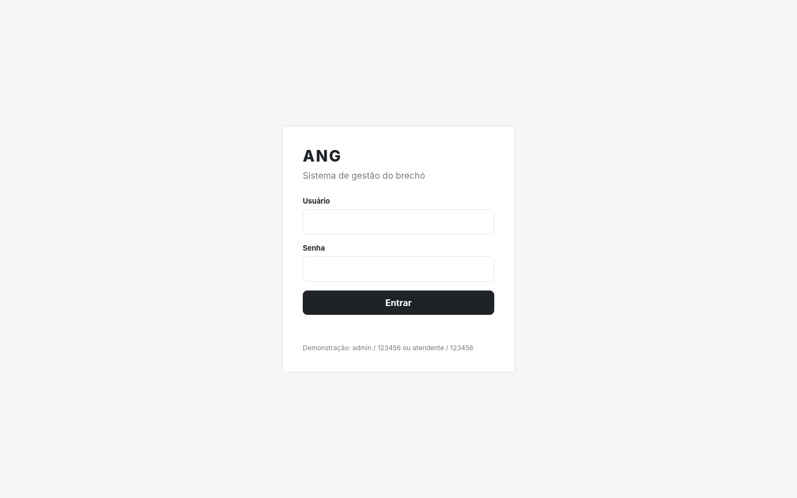
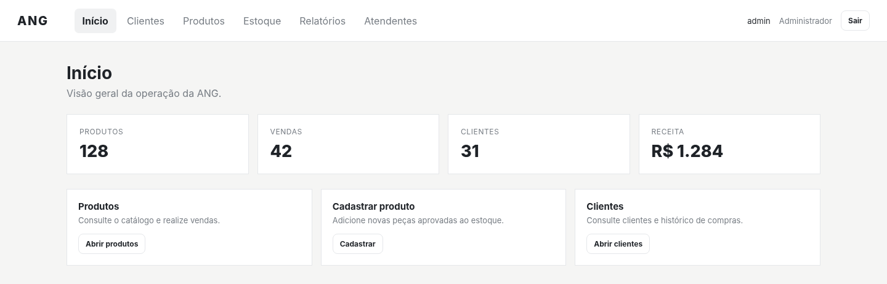
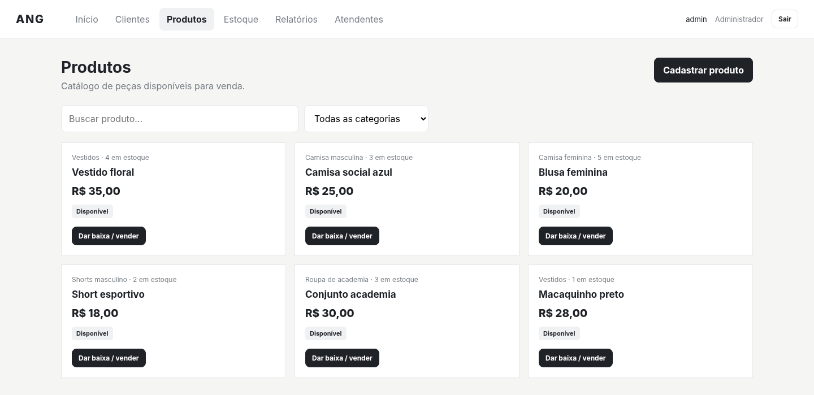
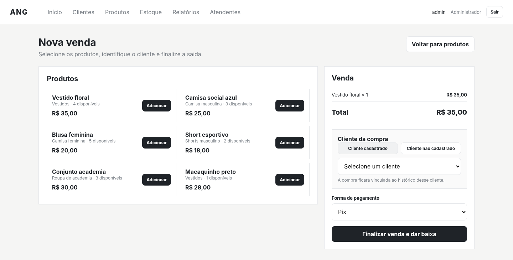
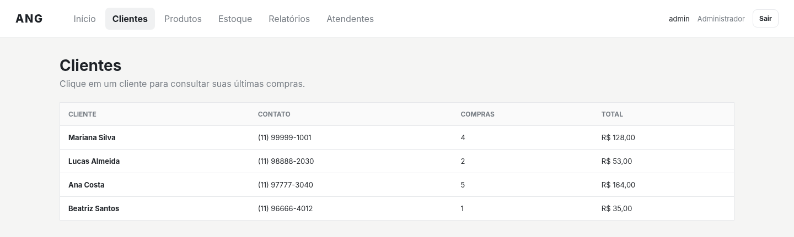
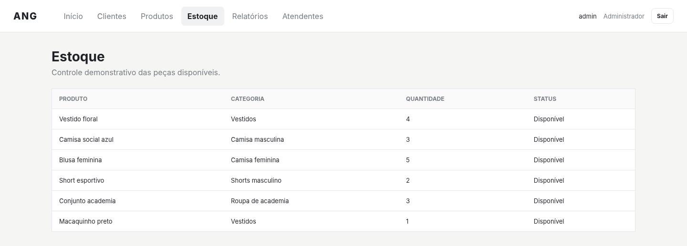

# Telas e protótipos — ANG

## Aplicação React atual

[Galeria das dez telas atuais](atual/README.md) · [Registro da captura](atual/capturas.json)

Capturas realizadas em navegador local a partir do código do repositório, com perfil isolado e dados de demonstração. A inspeção percorreu login, painel, triagem, catálogo, cadastro, venda, clientes, estoque, caixa e equipe. Nenhuma venda, doação ou cadastro foi confirmado.

## Protótipo HTML documentado pela equipe

As **13 capturas abaixo foram extraídas diretamente do PDF da equipe**, sem reconstruir ou alterar as interfaces. São evidências do protótipo HTML documentado, com dados de demonstração.

[Galeria completa e fichas das telas](fichas-de-telas.md) · [PDF original, 17 páginas](fontes/telasANG.pdf) · [Capturas de todas as páginas](evidencias/telas-ang/README.md) · [Protótipo HTML preservado](Protótipo_inicial_0.html)

| Acesso | Operação |
|---|---|
|  |  |
|  |  |
|  |  |

## Relação com a versão atual

O PDF descreve uma versão HTML com indicadores fixos, dois usuários de demonstração e área de atendentes apenas consultiva. O React atual acrescenta triagem, cadastro/edição de funcionários e resumo calculado a partir do estado local. As imagens extraídas do PDF pertencem à versão HTML; as novas capturas ficam na galeria React. Nenhuma das galerias apresenta dados operacionais reais de clientes ou de faturamento.

Veja as [fichas](fichas-de-telas.md) e a [rastreabilidade](../requisitos/rastreabilidade.md) para diferenças e pendências.
