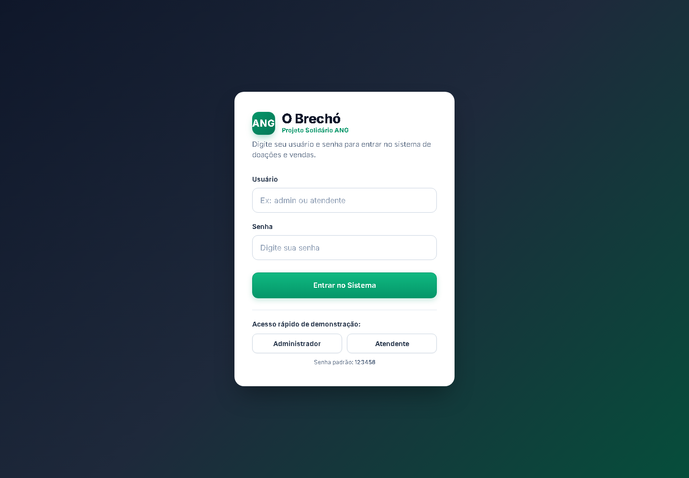
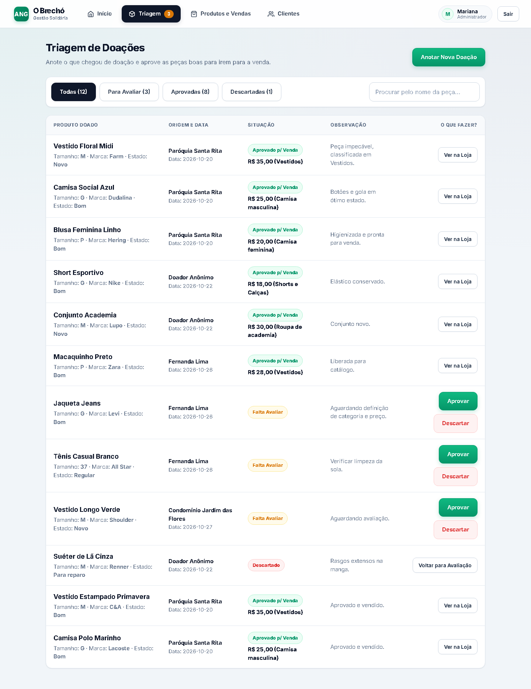
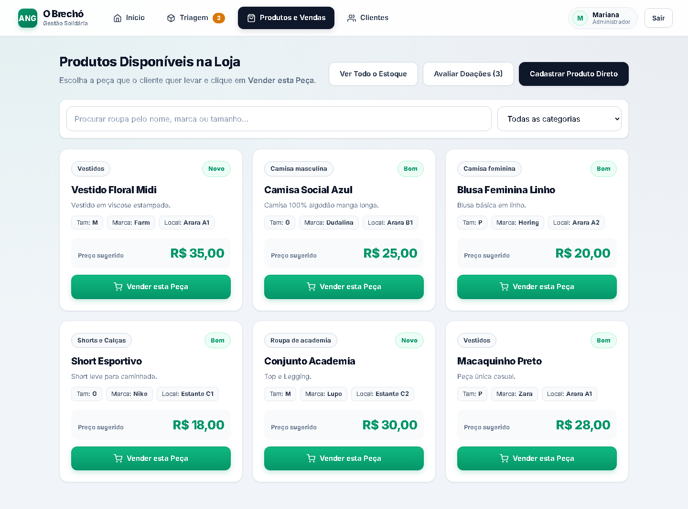
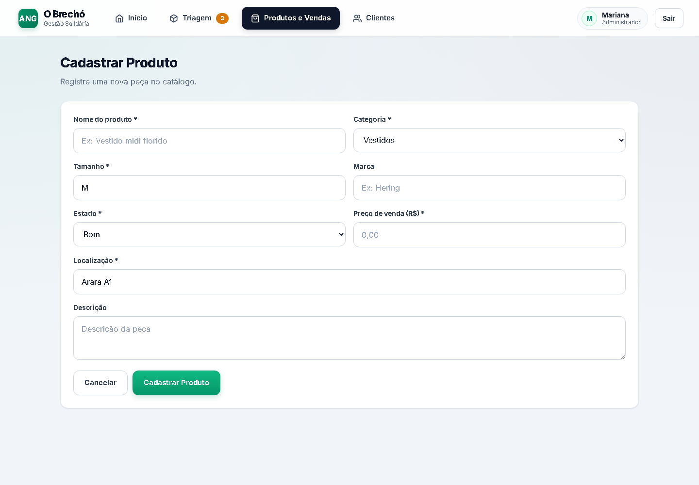
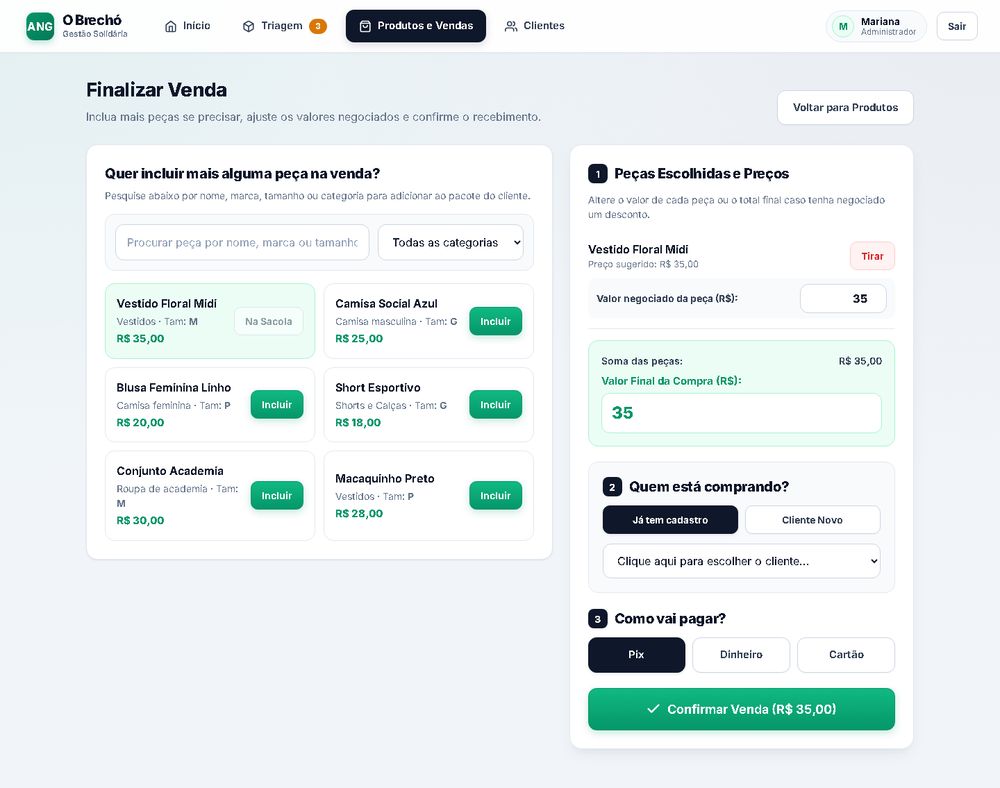
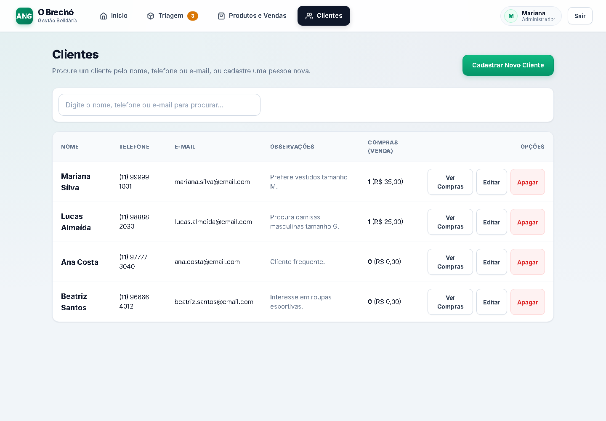
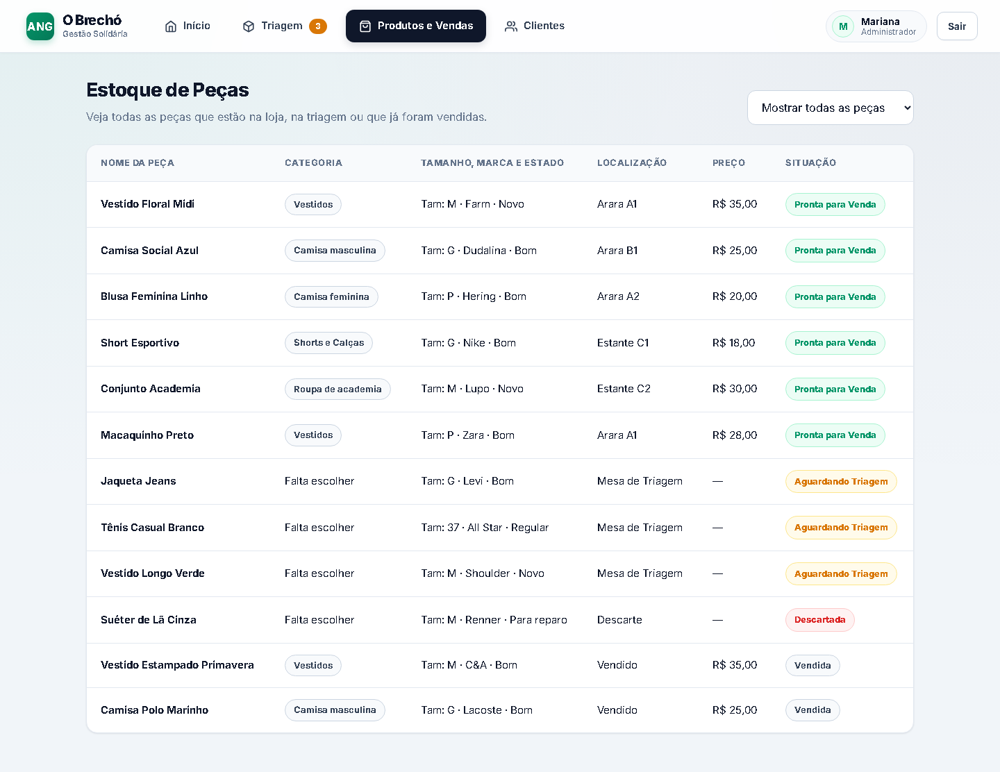
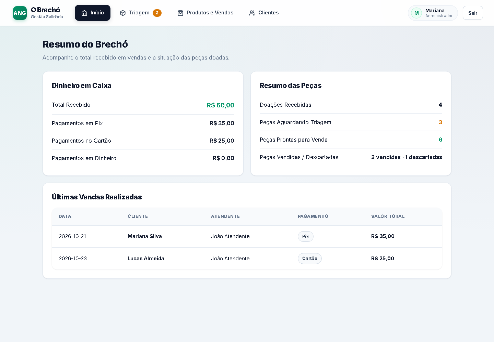
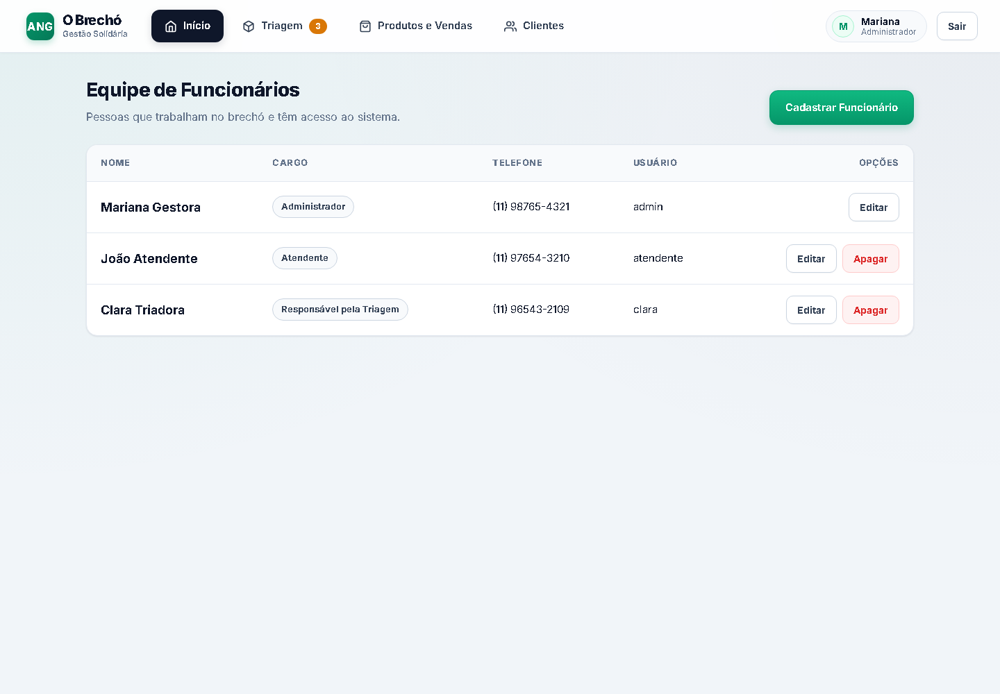

# Aplica??o React ? capturas atuais

Capturas reais realizadas em 2026-10-27, no Chrome 144, usando o c?digo do commit `c8ec5a8` sem altera??o de layout. Viewport de 1440 ? 1000, com captura da p?gina inteira quando necess?rio. Perfil de navegador isolado e seed de demonstra??o.

Foi realizado login pelo acesso demonstrativo de Administrador e navega??o pelas telas. Nenhuma venda, doa??o ou cadastro foi confirmado; esta galeria n?o comprova a execu??o completa de CT-01?CT-08. Os nomes, contatos e valores s?o dados de exemplo, sem rela??o comprovada com registros operacionais reais da ANG.

[Registro t?cnico](capturas.json) ? [Prot?tipo anterior](../fichas-de-telas.md) ? [Requisitos e lacunas](../../requisitos/rastreabilidade.md)

| Tela | Captura |
|---|---|
| Login atual | [Abrir imagem](01-login.png) |
| Painel inicial atual | [Abrir imagem](02-inicio.png) |
| Triagem atual | [Abrir imagem](03-triagem.png) |
| Catálogo atual | [Abrir imagem](04-produtos.png) |
| Formulário atual de produto | [Abrir imagem](05-cadastro-produto.png) |
| Formulário atual de venda, sem confirmação | [Abrir imagem](06-venda.png) |
| Clientes de demonstração | [Abrir imagem](07-clientes.png) |
| Estoque de demonstração | [Abrir imagem](08-estoque.png) |
| Resumo financeiro de demonstração | [Abrir imagem](09-resumo-caixa.png) |
| Equipe de demonstração | [Abrir imagem](10-equipe.png) |

## Login atual

T?tulo observado: **O Brechó**.

## Painel inicial atual

T?tulo observado: **Bom trabalho, Mariana!**.

## Triagem atual

T?tulo observado: **Triagem de Doações**.

## Catálogo atual

T?tulo observado: **Produtos Disponíveis na Loja**.

## Formulário atual de produto

T?tulo observado: **Cadastrar Produto**.

## Formulário atual de venda, sem confirmação

T?tulo observado: **Finalizar Venda**.

## Clientes de demonstração

T?tulo observado: **Clientes**.

## Estoque de demonstração

T?tulo observado: **Estoque de Peças**.

## Resumo financeiro de demonstração

T?tulo observado: **Resumo do Brechó**.

## Equipe de demonstração

T?tulo observado: **Equipe de Funcionários**.
