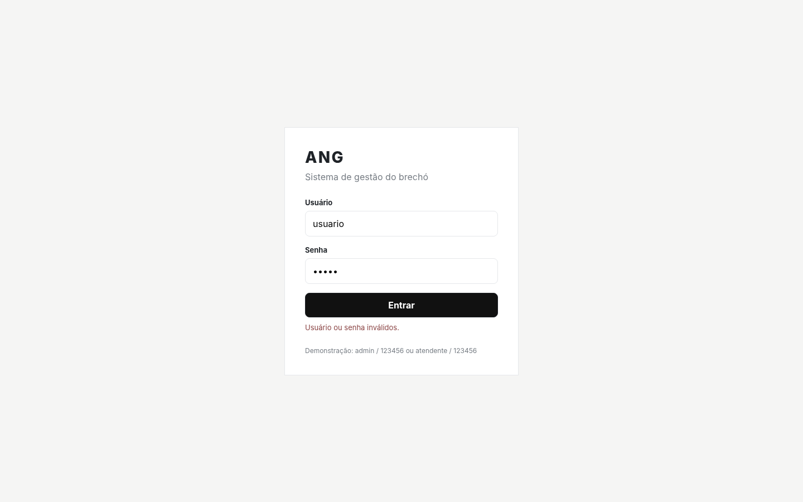
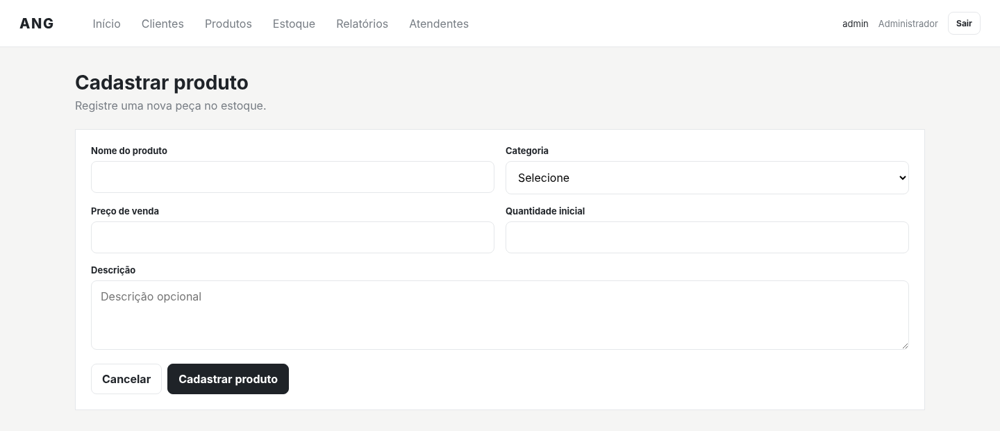
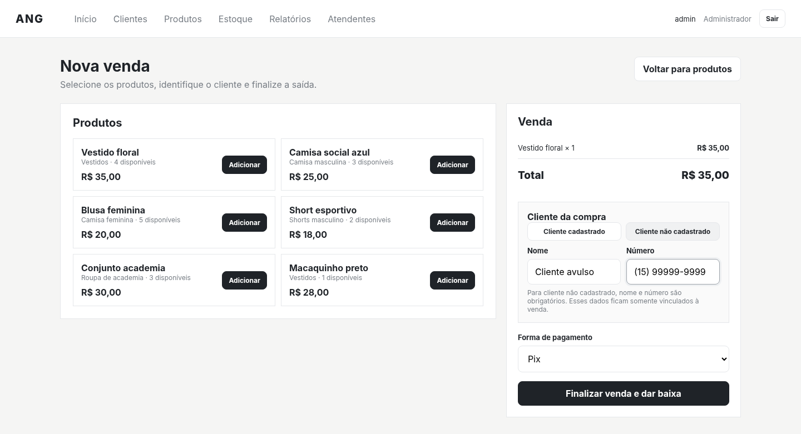
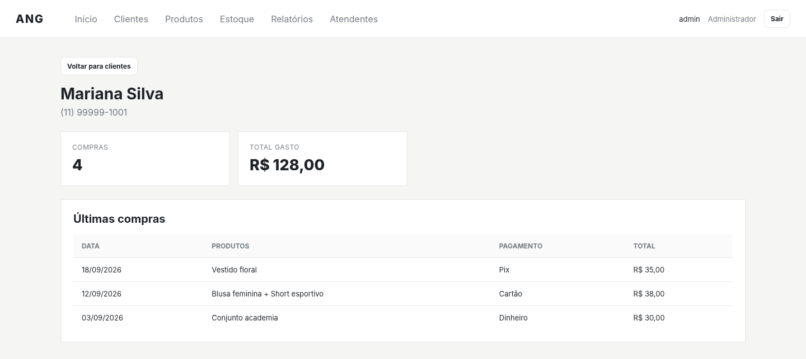
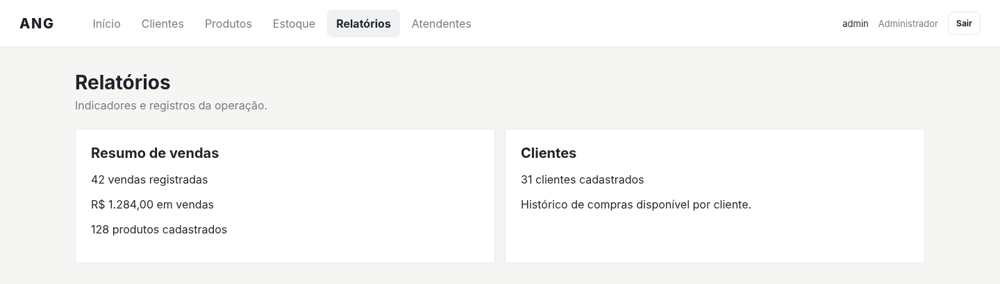
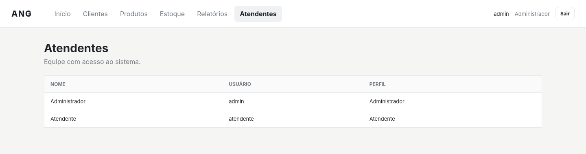
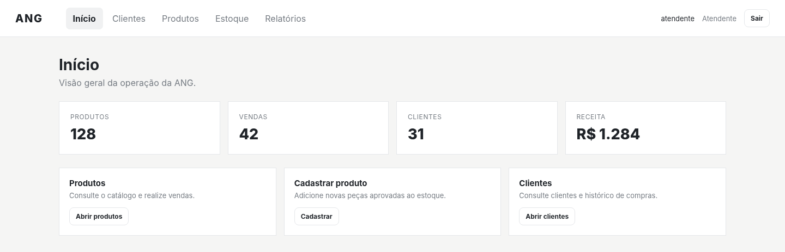

# Galeria e fichas das 13 telas

**Plataforma:** web. **Fonte:** [telasANG.pdf](fontes/telasANG.pdf). **Estado:** protótipo HTML documentado pela equipe em 2026, sem aceite anexado. Os nomes e números são dados de demonstração. As imagens são os bytes extraídos do PDF, sem redesenho.

Os números de página abaixo indicam posição física no PDF, não a numeração impressa.

| Tela | Página | Requisito / fluxo |
|---|---:|---|
| [Autenticação](#01-autenticacao) | 4 | RNF01 |
| [Credenciais inválidas](#02-credenciais-invalidas) | 5 | RNF01 |
| [Início — Administrador](#03-inicio-administrador) | 6 | Navegação / RNF04 |
| [Produtos](#04-produtos) | 7 | RF06, RF07 / UC06, UC07 |
| [Cadastro de produto](#05-cadastro-produto) | 8 | RF06 / UC06 |
| [Nova venda — cliente cadastrado](#06-venda-cliente-cadastrado) | 9 | RF07 / UC07 |
| [Nova venda — cliente avulso](#07-venda-cliente-avulso) | 10 | RF07 / UC07 |
| [Clientes](#08-clientes) | 11 | RF01 / UC01 |
| [Detalhe do cliente](#09-detalhe-cliente) | 12 | RF02 / UC02 |
| [Estoque](#10-estoque) | 13 | RF06, RF07 / UC06, UC07 |
| [Relatórios](#11-relatorios) | 14 | RF08 / UC08 |
| [Atendentes](#12-atendentes) | 15 | RF03 / UC03 |
| [Início — Atendente](#13-inicio-atendente) | 16 | RNF02 |

## Autenticação

**Origem:** página 4 do PDF. **Rastreio:** RNF01.

**Componentes e comportamento documentados:** Campos Usuário e Senha, botão Entrar e nota com credenciais de demonstração. Após login válido, apresenta Início.

**Relação com a implementação atual:** Login React em components/Login.tsx; continua demonstrativo.

[Conferir a página completa](evidencias/telas-ang/pagina-04.png).

## Credenciais inválidas

**Origem:** página 5 do PDF. **Rastreio:** RNF01.

**Componentes e comportamento documentados:** Mensagem de erro no login; permanece fora das páginas internas e permite corrigir as credenciais.

**Relação com a implementação atual:** A mensagem e a validação do React têm implementação própria em AuthService; não inferir equivalência só pela captura.

[Conferir a página completa](evidencias/telas-ang/pagina-05.png).

## Início — Administrador

**Origem:** página 6 do PDF. **Rastreio:** Navegação / RNF04.

**Componentes e comportamento documentados:** Painel com atalhos e indicadores de 128 produtos, 42 vendas, 31 clientes e receita de R$ 1.284, todos demonstrativos.

**Relação com a implementação atual:** O React usa views/inicio/InicioView.tsx com seus próprios dados e menu; não são números reais da ANG.

[Conferir a página completa](evidencias/telas-ang/pagina-06.png).

## Produtos

**Origem:** página 7 do PDF. **Rastreio:** RF06, RF07 / UC06, UC07.

**Componentes e comportamento documentados:** Busca por nome, filtro de categoria, cartões com preço e quantidade, cadastro e ação Dar baixa / vender. Esgotados ficam desabilitados.

**Relação com a implementação atual:** O React organiza peças unitárias e seus estados em views/produtos/ProdutosView.tsx.

[Conferir a página completa](evidencias/telas-ang/pagina-07.png).

## Cadastro de produto

**Origem:** página 8 do PDF. **Rastreio:** RF06 / UC06.

**Componentes e comportamento documentados:** Nome, categoria, preço e quantidade inicial obrigatórios; descrição opcional; cancelar retorna ao catálogo.

**Relação com a implementação atual:** React acrescenta características e localização em CadastroProdutoView.tsx; cadastro direto precisa ser conciliado com doação e aprovação obrigatórias.

[Conferir a página completa](evidencias/telas-ang/pagina-08.png).

## Nova venda — cliente cadastrado

**Origem:** página 9 do PDF. **Rastreio:** RF07 / UC07.

**Componentes e comportamento documentados:** Seleciona produtos, compõe carrinho, escolhe cliente e meio de pagamento, verifica quantidade e finaliza com baixa do estoque.

**Relação com a implementação atual:** React permite negociação por peça e total e emite comprovante; a consistência financeira precisa de cenário funcional próprio.

[Conferir a página completa](evidencias/telas-ang/pagina-09.png).

## Nova venda — cliente avulso

**Origem:** página 10 do PDF. **Rastreio:** RF07 / UC07.

**Componentes e comportamento documentados:** No protótipo documentado, nome e número são obrigatórios e vinculados somente à venda, sem cadastro permanente automático.

**Relação com a implementação atual:** Não transportar essa regra automaticamente para o modelo SQL atual, que exige cliente_id. O código React deve ser avaliado em sua própria versão.

[Conferir a página completa](evidencias/telas-ang/pagina-10.png).

## Clientes

**Origem:** página 11 do PDF. **Rastreio:** RF01 / UC01.

**Componentes e comportamento documentados:** Lista identificação, contato, quantidade de compras e total gasto. Selecionar uma linha abre o histórico.

**Relação com a implementação atual:** React possui manutenção de clientes além da consulta descrita nesta versão HTML.

[Conferir a página completa](evidencias/telas-ang/pagina-11.png).

## Detalhe do cliente

**Origem:** página 12 do PDF. **Rastreio:** RF02 / UC02.

**Componentes e comportamento documentados:** Resumo individual e últimas compras com data, produtos, pagamento e total. O PDF informa limite de oito registros recentes.

**Relação com a implementação atual:** React apresenta vendas do cliente sem o mesmo limite de oito; ainda falta agrupamento por categoria previsto em RF02.

[Conferir a página completa](evidencias/telas-ang/pagina-12.png).

## Estoque

**Origem:** página 13 do PDF. **Rastreio:** RF06, RF07 / UC06, UC07.

**Componentes e comportamento documentados:** Tabela de produtos, categorias, quantidades e disponibilidade; estoque reduzido após a venda na sessão do protótipo.

**Relação com a implementação atual:** React acompanha peças por status e persiste localmente em vez de comprovar estoque real da instituição.

[Conferir a página completa](evidencias/telas-ang/pagina-13.png).

## Relatórios

**Origem:** página 14 do PDF. **Rastreio:** RF08 / UC08.

**Componentes e comportamento documentados:** Indicadores estáticos: o próprio documento informa que os números não são recalculados pelo protótipo.

**Relação com a implementação atual:** React calcula resumo local de pagamentos e peças, porém não implementa o período e a consolidação diária exigidos.

[Conferir a página completa](evidencias/telas-ang/pagina-14.png).

## Atendentes

**Origem:** página 15 do PDF. **Rastreio:** RF03 / UC03.

**Componentes e comportamento documentados:** Consulta dos dois usuários demonstrativos. O documento informa que esta versão HTML não cria, edita, bloqueia ou exclui atendentes.

**Relação com a implementação atual:** React já oferece gestão local de funcionários; segurança de servidor ainda ausente.

[Conferir a página completa](evidencias/telas-ang/pagina-15.png).

## Início — Atendente

**Origem:** página 16 do PDF. **Rastreio:** RNF02.

**Componentes e comportamento documentados:** Mostra o painel sem a opção Atendentes no menu, demonstrando diferenciação visual por perfil no HTML.

**Relação com a implementação atual:** A navegação React mudou; a captura evidencia a versão HTML e não comprova autorização segura na aplicação atual.

[Conferir a página completa](evidencias/telas-ang/pagina-16.png).

## Fluxos e validação

O capítulo final do PDF (p. 17) descreve autenticação, cadastro, venda, histórico, disponibilidade e encerramento da sessão. Não há resultado de avaliação com participantes ou aceite. A navegação do protótipo reorganiza o layout abaixo de 900 e 620 pixels, segundo o PDF (p. 3), mas isso não constitui teste de responsividade do React atual.
