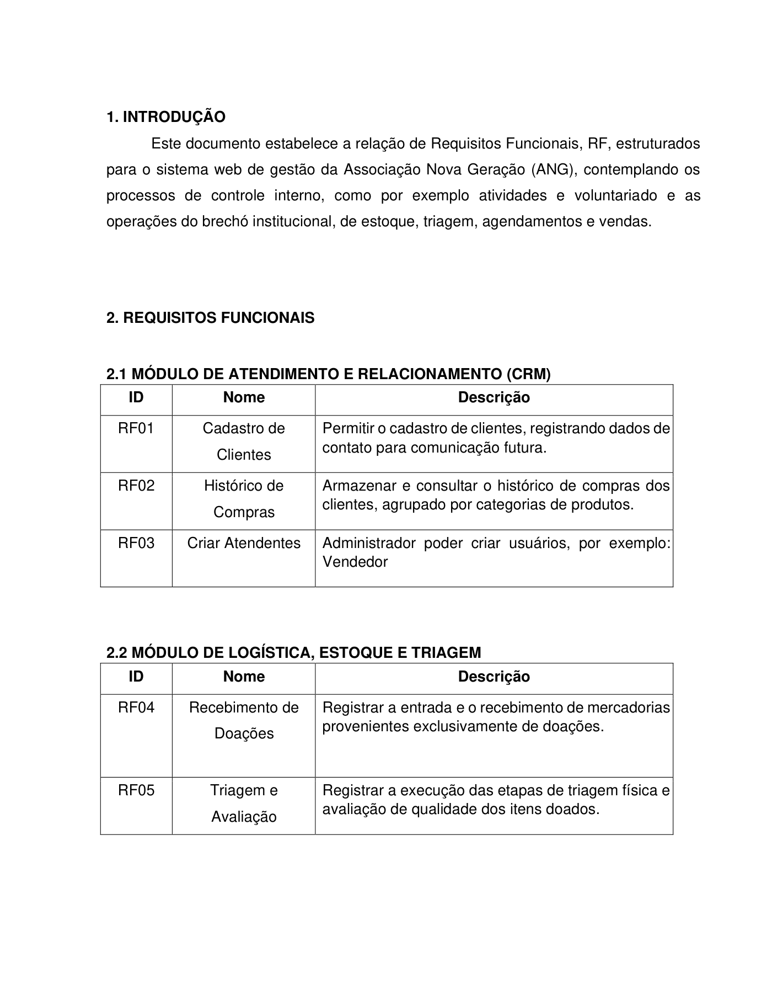

# Requisitos

O sistema deve atender ao cadastro de clientes, histórico de compras, gestão de atendentes, doações, triagem, categorias, vendas e relatórios.

| Documento | Conteúdo |
|---|---|
| [Especificação](especificacao-requisitos.md) | Requisitos RF01 a RF08, requisitos de qualidade e regras do brechó |
| [Acompanhamento](rastreabilidade.md) | O que já existe no código e o que falta fazer |
| [PDF de requisitos](fontes/RequisitosFuncionais_ANG.pdf) | Descrição dos requisitos funcionais |
| [Páginas do PDF](evidencias/requisitos-funcionais/README.md) | Consulta por imagem |
| [Estudo completo](../academico/fontes/2209ANG.pdf) | Análise do projeto e requisitos de qualidade |

## Como consultar

Leia a [especificação](especificacao-requisitos.md) para entender as funcionalidades e as regras do brechó. Use a [rastreabilidade](rastreabilidade.md) para distinguir o que está implementado do que permanece pendente e consulte os [casos de uso](../casos-de-uso/README.md) para os fluxos de operação.
