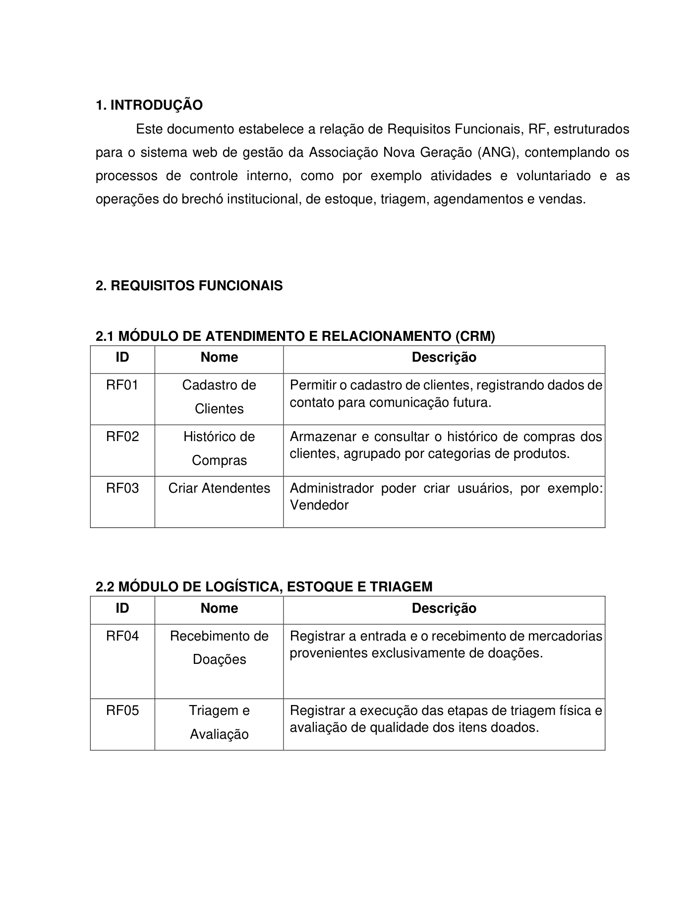

# Requisitos — O-BRECHÓ

Os identificadores oficiais dos documentos da equipe foram preservados: **RF01–RF08** e **RNF01–RNF10**.

- [Especificação preenchida](especificacao-requisitos.md): requisitos e regras documentadas.
- [Matriz de rastreabilidade](rastreabilidade.md): fonte, caso de uso, código e lacunas.
- [PDF de requisitos funcionais](fontes/RequisitosFuncionais_ANG.pdf): cinco páginas originais.
- [Capturas das cinco páginas](evidencias/requisitos-funcionais/README.md).
- [Estudo completo](../academico/fontes/2209ANG.pdf): RF nas pp. 15–17 e RNF nas pp. 17–18.

A documentação distingue o requisito especificado pela equipe da funcionalidade realmente implementada. Não há termo de aceite anexado.
